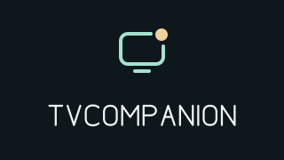
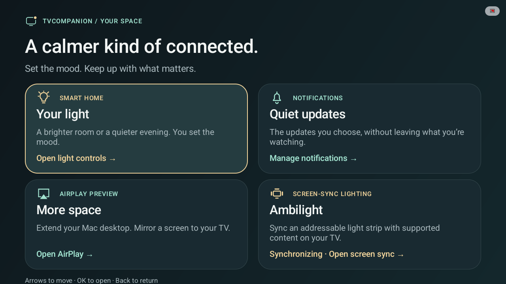
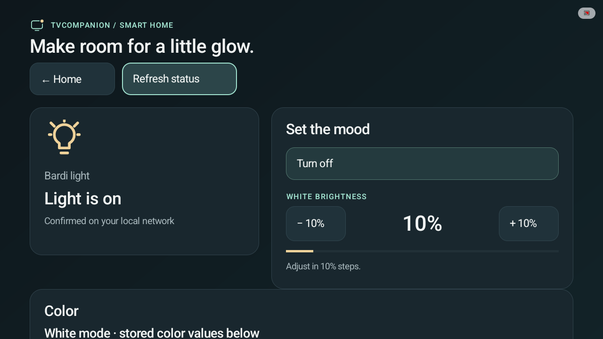
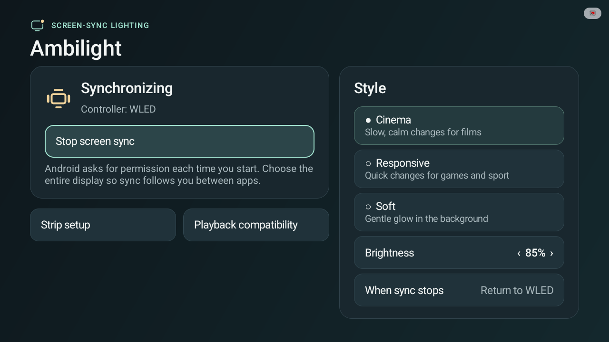
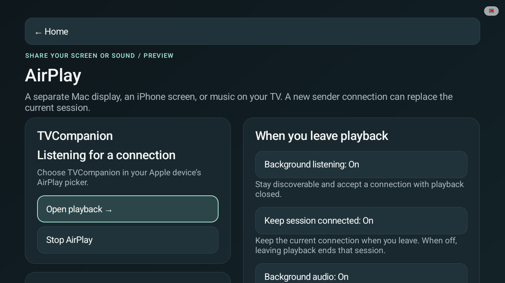
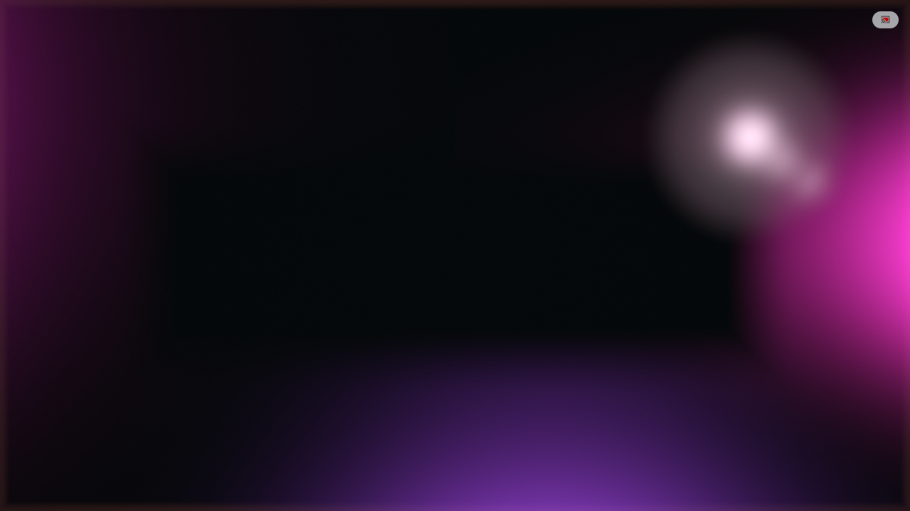
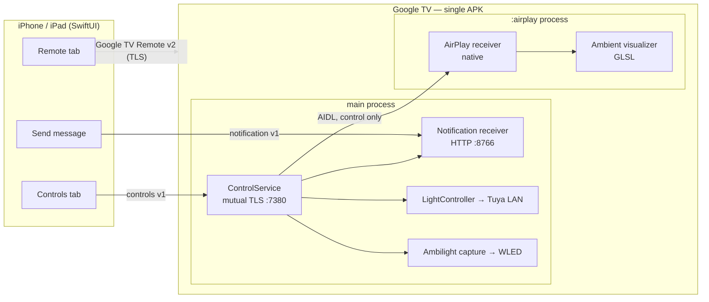

# TVCompanion



**Turn a Google TV into a calm, local-first hub for the room, controlled from your iPhone.**

TVCompanion is an Android TV app and an iPhone/iPad companion. The TV drives the room's smart light, syncs an LED strip to the picture, receives AirPlay from Apple devices, shows quiet notifications, and turns music into a visualizer. The iPhone acts as its remote and control panel. Everything stays on your home network: no cloud, no accounts, no analytics.



## What it does

| | On the TV | From the iPhone |
|---|---|---|
| **Smart light** | Power, brightness and colour presets for a Bardi (Tuya) bulb over the local network. Every change is confirmed by reading the lamp back. | On/off and colour presets in the Controls tab |
| **Ambilight** | Screen capture drives a WLED LED strip around the TV in real time, with Cinema, Responsive and Soft styles | Start and stop remotely |
| **AirPlay** | A built-in receiver: Mac extended desktop, iPhone mirroring and music, in its own process | Background listening on/off |
| **Ambient** | Music visualizers that react to the beat and colour the room: Aurora, Strings, Slow Dusk, Chromatic Flow, Edge Orbit and Bounce | Open or close with a chosen look |
| **Notifications** | Small, dismissible overlays over whatever is playing, with source filters and privacy modes | Send normal or urgent messages, or switch the receiver on/off |
| **Remote** | | Google TV Remote v2: D-pad, media keys, voice and keyboard |

<table>
<tr>
<td></td>
<td></td>
</tr>
<tr>
<td></td>
<td></td>
</tr>
</table>

*Bounce, bottom right, is built for Ambilight: each time the ball hits an edge, that part of the LED strip lights up in the room.*

## Engineering highlights

- **Local-first by design.** Devices are controlled directly over the LAN (Tuya 3.5, WLED/DDP, AirPlay, Google TV Remote v2). There is no polling loop, cloud bridge, notification history or telemetry.
- **Process isolation where it matters.** The AirPlay receiver (native networking, decoding and rendering) runs in a private `:airplay` process. The main app talks to it over a control-only AIDL interface; no media frames cross the boundary.
- **Secure device control.** The iPhone Controls tab uses **mutual TLS** with an AndroidKeyStore server key, key pinning on both sides and code-based pairing ([contract](contracts/controls-v1.md)). Commands set explicit states, never toggles, and the UI shows only what the TV confirms.
- **Failure isolation.** Each feature has a headless entry point and fails alone: a lamp that doesn't answer never blocks AirPlay or Ambilight.
- **A measured GPU budget.** Ambient looks are GLSL shaders against a small contract. Per-frame maths runs in vertex stages; an automatic 540p fallback protects 30 fps; a test fails the build on patterns that make motion jump.
- **Photosensitivity-aware visuals.** The music-reactive looks avoid flashes and per-beat colour steps, use smoothed audio envelopes, and cap brightness swings.

## Architecture



The Android code is split into `core` (domain, design system, Ambilight engine), `features` (screens and services), `integrations` (Tuya, AirPlay runtime, native receiver) and `ipc`. The iOS app keeps its wire formats and state logic in a tested Swift package (`TVCompanionKit`). See [architecture](docs/ARCHITECTURE.md) and [decisions](docs/DECISIONS.md).

## Security model

| Channel | Protection | Notes |
|---|---|---|
| iPhone Controls → TV | Mutual TLS; both keys pinned at pairing | 6-digit pairing code, up to 4 devices, at most 2 connections, 10 s deadline per request |
| iPhone Remote → TV | Google TV Remote v2 TLS, pinned | The TV's own remote service |
| Notifications → TV | **Plaintext HTTP + PIN**, LAN only | An accepted, documented risk that keeps iOS Shortcuts automations working; notifications are display-only. The planned move to App Intents over the secure channel is in [decision 22](docs/DECISIONS.md#notification-transport--2026-11-22). |

Known open items, such as the connection-slot exhaustion limit, are tracked in [verification](docs/VERIFICATION.md).

## Measured performance

Measured on the test TV (4 cores, 1.4 GB RAM) with AirPlay music, Ambient and Ambilight all running ([full audit](docs/VERIFICATION.md#ambient-performance-audit--2026-11-22)):

- **All six Ambient looks hold 30 fps.** GPU time is 9–13.5 ms per frame against a budget of about 14 ms.
- **Idle in the background:** about 1% CPU, no wake locks or alarms, about 78 MB total memory.
- **Ambilight capture:** about 19% of one core while running.

## Repository layout

| Path | What's inside |
|---|---|
| [`android/`](android/) | The Android TV app (Kotlin, single APK, `:airplay` process, native receiver via NDK) |
| [`ios/`](ios/) | The iPhone/iPad companion (SwiftUI) and its Swift packages |
| [`contracts/`](contracts/) | Wire contracts: [notifications v1](contracts/notifications-v1.md) and [Quick Controls v1](contracts/controls-v1.md) |
| [`docs/`](docs/) | Architecture, decisions, design notes, verification records and history |

## Getting started

Requirements: JDK 17, Android SDK 34, NDK 27.2.12479018 and CMake 3.22.1 for the TV app; Xcode 16+ (iOS 17+) for the companion. No device credentials or signing secrets are needed to build or run the tests.

```sh
# Android TV app
python3 scripts/prepare-airplay-native.py        # fetches and verifies pinned native dependencies
cd android && ./gradlew test :app:assembleDebug  # APK: android/app/build/outputs/apk/debug/app-debug.apk

# iPhone/iPad app
swift test --package-path ios/TVCompanionKit
xcodebuild -project ios/TVCompanion.xcodeproj -scheme TVCompanion -destination 'generic/platform=iOS Simulator' CODE_SIGNING_ALLOWED=NO build
```

Then follow [Android setup](docs/ANDROID_SETUP.md) to install the app, provision the light, set up notifications and pair the iPhone. The [iOS guide](ios/README.md) covers pairing the remote.

> **Status:** a personal project, tested on one home setup (a Skyworth Google TV on Android 14, an iPhone 12 Pro Max, a Bardi RGBWW bulb and a WLED strip). The native receiver targets that TV's 32-bit ARM ABI. It is not a store release.

## How it was built

TVCompanion is developed with AI coding assistants (Claude Code and Codex); their commits carry co-author trailers. The maintainer owns the product direction, the design and security decisions, and acceptance: every feature here was tested on the real TV and devices, and several AI proposals were rejected or reworked along the way (see [verification](docs/VERIFICATION.md) and [decisions](docs/DECISIONS.md)). Phase-by-phase detail is in the [project history](docs/PROJECT_HISTORY.md).

## Documentation

[Architecture](docs/ARCHITECTURE.md) · [Decisions](docs/DECISIONS.md) · [Design](docs/DESIGN.md) · [Verification](docs/VERIFICATION.md) · [Android setup](docs/ANDROID_SETUP.md) · [iOS](ios/README.md) · [Contributing](CONTRIBUTING.md) · [Provenance](docs/PROVENANCE.md) · [Licence assessment](docs/LICENSE_COMPLIANCE.md)

## License

No license has been chosen yet, so all rights are reserved. Don't assume an open-source license from the repository being public. Reused components and their origins are listed in [source provenance](docs/PROVENANCE.md).
