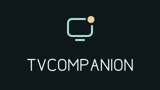

# TVCompanion



A local-first Google TV hub with Apple-device clients. Control your room, receive quiet updates, and grow capabilities without coupling the UI to device protocols.

## Platforms

| Directory | Target | Status |
| --- | --- | --- |
| [`android/`](android/) | **Android TV / Google TV**, with TV screens and D-pad input; not an Android phone app | Bardi light controls, notifications and an integrated AirPlay video preview |
| [`ios/`](ios/) | **iPhone and iPad** companion, with **Mac support planned for evaluation** | Native Remote v2 pairing/control and `alert`/`alert2` sender; device validation pending |
| [`contracts/`](contracts/) | Integration documentation and synthetic examples | Notification HTTP v1 contract |
| [`docs/`](docs/) | Architecture, design, development and decisions | Foundation documentation |

Google TV is the primary orchestration host; iPhone, iPad and future Mac software are clients, not peer hubs. The planned AirPlay receiver will be bundled in the single TVCompanion APK and run in a dedicated `:airplay` process, owning discovery, decoding and rendering. Mac media will go directly to that receiver; Binder/AIDL carries control, status and lifecycle events only. AirPlay video is integrated in the same APK as a foreground-only preview. The initial [TV experiment](docs/phase-2/TV_RECEIVER_EXPERIMENT.md) proved Mac extended desktop; the [integrated preview](docs/phase-2/SINGLE_APK_INTEGRATION.md) is now installed and user-confirmed. The newer audio/background candidate is implemented but awaits device review.

`ios/` is the Apple application workspace name, not a claim of current macOS support. Android and Apple applications have independent builds, dependencies, signing, and releases. CleanYourTV remains an external launcher; TVCompanion does not depend on or modify it.

## Android application

- A TV dashboard with two large feature cards, shared typography, focus states and native vector icons.
- A compact light-control page and categorized notification settings with local previews, explicit appearance choices and masked pairing details. See the [UI/UX research](docs/UI_UX_RESEARCH.md).
- Direct Tuya 3.5 LAN light status, power, white brightness and a guarded HSV color-control preview, adapted from the existing Bardi proof of concept. Writes require fresh state and readback; failures remain unconfirmed until refreshed.
- Notification settings, source filtering, previews, transient non-interactive overlays, expiry, deduplication, and bounded queues, adapted from TVNotify.
- `alert2` uses the existing notification endpoint and a large, dismissible TV overlay. Existing appearance/privacy settings and queue limits still apply.
- An AirPlay preview card opens the same APK’s receiver: native networking and video rendering stay in `:airplay`, with a replaceable engine and control-only AIDL. Discovery, session retention, hidden audio and automatic video presentation have separate controls.
- No background lamp polling, dashboard animation loop, notification history, cloud bridge, analytics, automatic receiver restart, or boot service.
- Protocol behavior, UI-independent state handling, and transport regression tests.

The new application identity is `id.poncol.tvcompanion`. It does not replace existing apps or inherit their private settings. Notification reception is opt-in and defaults to port **8766**, so it can coexist with TVNotify's 8765 during development. Use one receiver for normal operation to avoid duplicate overlays and resident processes.

The receiver currently uses authenticated **unencrypted LAN HTTP** inherited from the prototype. Use non-sensitive demo messages on a trusted LAN. Encrypted transport and stronger pairing remain release work. Automatic capture of other iPhone apps' notifications is not implemented or established by this receiver.

The [iPhone/iPad app](ios/README.md) pairs with Google TV Remote v2 for D-pad and media keys, and sends `alert`/`alert2` messages through the TVCompanion notification receiver. Its pure protocol kit, Keychain-backed credentials, network adapters and SwiftUI views have separate boundaries. Local builds pass; pairing and delivery require device testing.

## Phase 1 refactor

The `review/phase-1-architecture` branch contains a targeted refactor: owned Tuya cancellation and fragmented-read deadlines, typed notification lifecycle state, and testable listener/overlay session coordination. The accepted Phase 1 candidate was `0.3.0-phase1-preview`, with 59 passing tests and zero lint findings, with installation and lamp/notification functionality now user-confirmed. See [implementation details](docs/phase-1/IMPLEMENTATION_CHANGELOG.md). The command endpoint remains design-only. The Phase 2 preview now implements the private receiver IPC boundary; no external command server is added.

## Phase 2 integration

`0.4.0-airplay-preview` bundles the receiver in the single TVCompanion APK. The main-process AirPlay screen controls a private `:airplay` service through AIDL; JNI, native networking, MediaCodec and the playback surface stay in that process. See the [integration record](docs/phase-2/SINGLE_APK_INTEGRATION.md) and [architecture decision](docs/DECISIONS.md#phase-2-packaging-correction--2026-10-28).

The `0.5.3-airplay-ui-preview` candidate adds grouped TV controls, per-setting explanations, actionable recovery, accurate media/discovery status and playback controls that appear on remote interaction. It separates **Background listening** (off by default), **Keep session connected** (on), **Background audio** (off), and **Auto-open incoming video** (on). Open **AirPlay → Open receiver**, then choose **TVCompanion** on the sender. A retained connection can outlive playback without remaining discoverable; hidden audio requires both session retention and Background audio. Incoming video opens once when enabled and Android permits. Open/Stop controls remain in the app, with an ongoing foreground-service notification where the TV exposes it. Idle listening does not auto-start after reboot/app restart. See [audio/background implementation and pending device review](docs/phase-2/AUDIO_AND_BACKGROUND.md), including Spotify AirPlay setup. The optional [lab](experiments/airplay-lab/README.md) reuses the same runtime/engine and is not a production dependency.

The **0.6.0 Bardi color preview** adds six presets, hue/saturation/color-brightness steps and a return to white mode. New writes require supported fresh status and separate readback; color never turns power on implicitly. Local checks pass, and the user confirmed the requested color controls work on the lamp. See [profile, behavior and verification](docs/BARDI_COLOR_CONTROL.md).

## Get started

See [Android setup](docs/ANDROID_SETUP.md) for build requirements, optional development provisioning, and notification setup. Actual checks and remaining gaps are recorded in [verification](docs/VERIFICATION.md). No device credentials or signing secrets are required to build or run unit tests.

```sh
python3 scripts/prepare-airplay-native.py
cd android
./gradlew :app:assembleDebug :core:domain:test :integrations:airplay-runtime:testDebugUnitTest :ipc:airplay-contract:testDebugUnitTest :integrations:tuya-lan:testDebugUnitTest :features:notifications:testDebugUnitTest :app:lintDebug
```

Full APK builds require JDK 17, Android SDK/build-tools 34, NDK 27.2.12479018 and SDK CMake 3.22.1. The preparation script verifies and caches pinned native dependencies. This preview targets the validated TV’s 32-bit ARM ABI; it is not a general Play Store release. The APK is `android/app/build/outputs/apk/debug/app-debug.apk`. This is a development foundation, not a production release. The app is installed and basic functionality is user-confirmed; broader lifecycle and overlay coexistence still require real-device validation; benchmark work is intentionally out of scope.

## Architecture and contribution

Read [architecture](docs/ARCHITECTURE.md), [design](docs/DESIGN.md), [decisions](docs/DECISIONS.md), and [contribution guidelines](CONTRIBUTING.md). Keep UI replaceable, normalize vendor state behind adapters, and introduce abstractions only at real boundaries.

No repository license has been selected yet. See [source provenance](docs/PROVENANCE.md) for reused components. Do not assume an open-source license from repository visibility alone.

The [licensing assessment](docs/LICENSE_COMPLIANCE.md) records proposed release obligations and unresolved ownership/dependency checks; the [receiver boundary review](docs/phase-2/RECEIVER_BOUNDARY_REVIEW.md) proposes build-time replacement of the native receiver. Neither document adopts a license or implements AirPlay.
